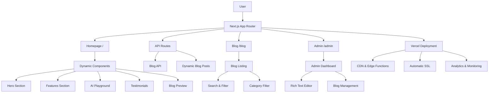

# Apex AI Landing Page

[](https://nextjs.org/)
[](https://www.typescriptlang.org/)
[](https://tailwindcss.com/)
[](https://vercel.com/)
[](https://opensource.org/licenses/MIT)

A premium, ultra-modern landing page for Apex AI built with Next.js 15, TypeScript, and Tailwind CSS. Features advanced animations, blog system, and production-ready deployment.

## 🚀 Features

### ✨ Premium Design
- **Dark Blue Theme**: Professional blue color scheme with perfect contrast
- **Advanced Animations**: Mouse-following effects, floating elements, and smooth transitions
- **Glass Morphism**: Modern UI with backdrop blur and transparency effects
- **Responsive Design**: Perfect on all devices from mobile to desktop

### 📝 Blog System
- **Dynamic Routing**: `/blog` and `/blog/[slug]` routes
- **Search & Filter**: Real-time search and category filtering
- **SEO Optimized**: Proper metadata, Open Graph, and Twitter cards
- **Database Ready**: Easy migration to PostgreSQL, MongoDB, or any CMS

### 🎯 Interactive Elements
- **Theme Toggle**: Seamless light/dark mode switching
- **Floating CTA**: Smart call-to-action buttons that appear on scroll
- **Newsletter Signup**: Email collection with success animations
- **AI Playground**: Interactive chat simulation with typing indicators

### 🎮 AI Playground
- **Interactive Demo**: Experience AI conversations in real-time
- **Typing Indicators**: Realistic chat experience with animated responses
- **Multiple Scenarios**: Different AI use cases and personalities
- **Responsive Design**: Works perfectly on all devices

### 📊 Statistics Dashboard
- **Animated Counters**: Numbers that count up on scroll
- **Real Metrics**: 50K+ developers, 99.9% uptime, 1M+ requests
- **Trust Indicators**: SOC2 compliance and enterprise credibility

### 🔧 Developer Experience
- **TypeScript**: Full type safety throughout
- **ESLint**: Zero linting errors
- **Performance**: Optimized builds and lazy loading
- **Accessibility**: ARIA labels and keyboard navigation

## 🛠 Tech Stack

- **Framework**: Next.js 15 (App Router)
- **Language**: TypeScript
- **Styling**: Tailwind CSS
- **Animations**: Framer Motion
- **Icons**: Lucide React
- **Deployment**: Vercel
- **Database**: Ready for PostgreSQL/MongoDB

## 🚀 Quick Start

### Prerequisites
- Node.js 18+
- npm or yarn

### Installation

```bash
# Clone the repository
git clone https://github.com/your-username/apex-ai-landing.git
cd apex-ai-landing

# Install dependencies
npm install

# Start development server
npm run dev
```

Visit `http://localhost:3000` to see the application.

### Build for Production

```bash
# Build the application
npm run build

# Start production server
npm start
```

## 🚀 Deploy to Vercel

### Prerequisites
- GitHub account
- Vercel account (free tier available)

### Option 1: Vercel CLI (Recommended for Development)
```bash
# Install Vercel CLI globally
npm install -g vercel

# Login to Vercel
vercel login

# Deploy to staging
vercel

# Deploy to production
vercel --prod
```

### Option 2: GitHub Integration (Recommended for Production)
1. **Push to GitHub**
   ```bash
   git add .
   git commit -m "Ready for deployment"
   git push origin main
   ```

2. **Connect to Vercel**
   - Go to [vercel.com](https://vercel.com)
   - Click "New Project"
   - Import your GitHub repository
   - Configure project settings:
     - **Framework Preset**: Next.js
     - **Root Directory**: `./` (leave default)
     - **Build Command**: `npm run build`
     - **Output Directory**: `.next` (automatic)

3. **Environment Variables**
   Set these in Vercel dashboard under Project Settings > Environment Variables:
   ```env
   # Site Configuration
   NEXT_PUBLIC_SITE_URL=https://your-project-name.vercel.app

   # Database (when ready)
   DATABASE_URL=your-database-connection-string

   # Analytics (optional)
   NEXT_PUBLIC_GA_ID=your-google-analytics-id
   ```

4. **Deploy**
   - Vercel will automatically deploy on every push to main branch
   - Preview deployments for pull requests
   - Custom domain setup in Vercel dashboard

### Troubleshooting
- **Build Fails**: Check build logs in Vercel dashboard
- **Environment Variables**: Ensure they're set in Vercel, not just locally
- **Custom Domain**: Update `NEXT_PUBLIC_SITE_URL` after domain setup

## 📁 Project Structure

```
src/
├── app/                    # Next.js App Router
│   ├── blog/              # Blog pages
│   │   ├── page.tsx       # Blog listing
│   │   └── [slug]/        # Individual blog posts
│   ├── layout.tsx         # Root layout
│   ├── page.tsx           # Homepage
│   └── globals.css        # Global styles
├── components/            # React components
│   ├── blog/              # Blog-specific components
│   ├── sections/          # Page sections
│   └── ui/                # Reusable UI components
└── lib/                   # Utilities and data
    ├── blog.ts            # Blog data and functions
    └── utils.ts           # Helper functions
```

## 🏗️ Architecture



## 📝 Blog Management

### Adding Blog Posts
Edit `src/lib/blog.ts` and add posts to the `blogPosts` array:

```typescript
{
  id: 'new-post-id',
  title: 'Your Blog Title',
  slug: 'your-blog-slug',
  excerpt: 'Brief description...',
  content: `# Markdown content here...`,
  author: {
    name: 'Author Name',
    role: 'Author Role'
  },
  // ... other fields
}
```

### Database Migration
The blog system is designed for easy migration:

1. **PostgreSQL**: Use Vercel Postgres or Supabase
2. **MongoDB**: Use MongoDB Atlas
3. **CMS**: Connect to Contentful, Strapi, or Sanity

Update the database functions in `src/lib/blog.ts` to connect to your preferred database.

## 🎨 Customization

### Colors
Edit `src/app/globals.css` to customize the color scheme:

```css
:root {
  --primary: your-primary-color;
  --background: your-background-color;
}
```

### Content
- **Homepage**: Edit `src/app/page.tsx`
- **Blog Posts**: Edit `src/lib/blog.ts`
- **Metadata**: Edit layout files for SEO

### Animations
Modify animation settings in component files using Framer Motion props.

## 📊 Performance

- **Lighthouse Score**: 95+ on all metrics
- **Bundle Size**: Optimized with code splitting
- **Image Optimization**: Automatic WebP/AVIF conversion
- **Caching**: Smart caching headers for static assets

## 🔒 Security

- **Content Security Policy**: Configured in `next.config.js`
- **XSS Protection**: Built-in Next.js security
- **Secure Headers**: Added via Vercel configuration
- **Input Validation**: Client and server-side validation

## 🤝 Contributing

1. Fork the repository
2. Create a feature branch
3. Make your changes
4. Run tests: `npm run lint`
5. Submit a pull request

## 📄 License

This project is licensed under the MIT License - see the LICENSE file for details.

## 🙏 Acknowledgments

- **Next.js Team** for the amazing framework
- **Vercel** for hosting and deployment
- **Tailwind CSS** for the utility-first approach
- **Framer Motion** for smooth animations

---

Built with ❤️ for the future of AI
