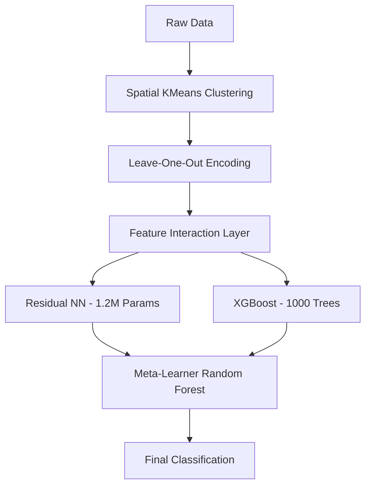

# 3e0 California Housing Classification: Hybrid Residual-Ensemble Pipeline

## 4cb Project Overview
This project features a high-capacity classification system for the California Housing dataset. By integrating deep learning (ResNet) and gradient boosting (XGBoost) through a meta-learner stacking strategy, we achieved a peak validation accuracy of **91.45%**.

## 3d73fe Technical Architecture
Our Hybrid Residual-Ensemble Pipeline bridges the gap between neural function approximation and tree-based decision logic:

## 4ca Performance Benchmarks
| Model | Accuracy | F1-Score | Training Epochs | Params |
| :--- | :--- | :--- | :--- | :--- |
| XGBoost Baseline | 90.94% | 0.90 | N/A | N/A |
| Residual NN (Scaled) | 88.00% | 0.88 | 100 | 1,225,217 |
| **Stacked Ensemble** | **91.45%** | **0.91** | **Hybrid** | **Meta-Stack** |

## 9ea Engineering Highlights
- **Spatial Clustering**: 150-node KMeans clustering of GPS coordinates.
- **LOO Encoding**: High-resolution categorical encoding to prevent target leakage.
- **Feature Interaction**: Sophisticated terms like `income_per_room` and `wealth_density` to capture socio-economic nuance.

## 4dc License
This project is licensed under the MIT License - see the [LICENSE](LICENSE) file for details.
